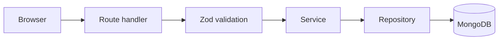
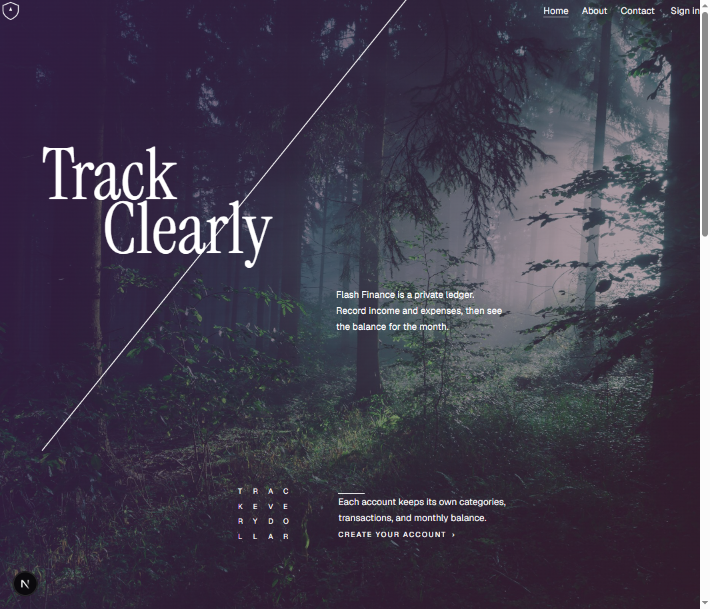
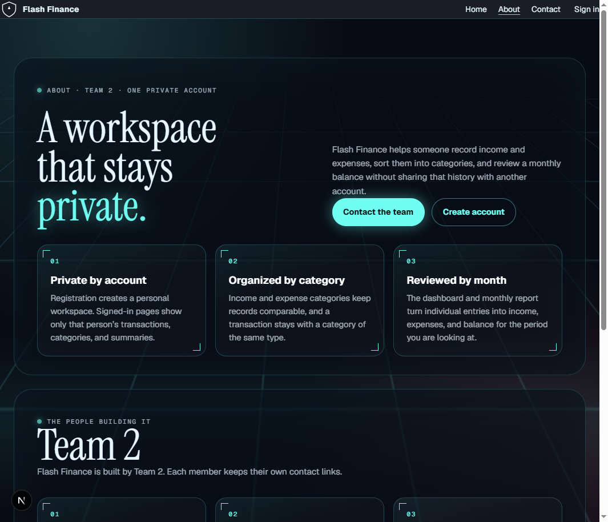
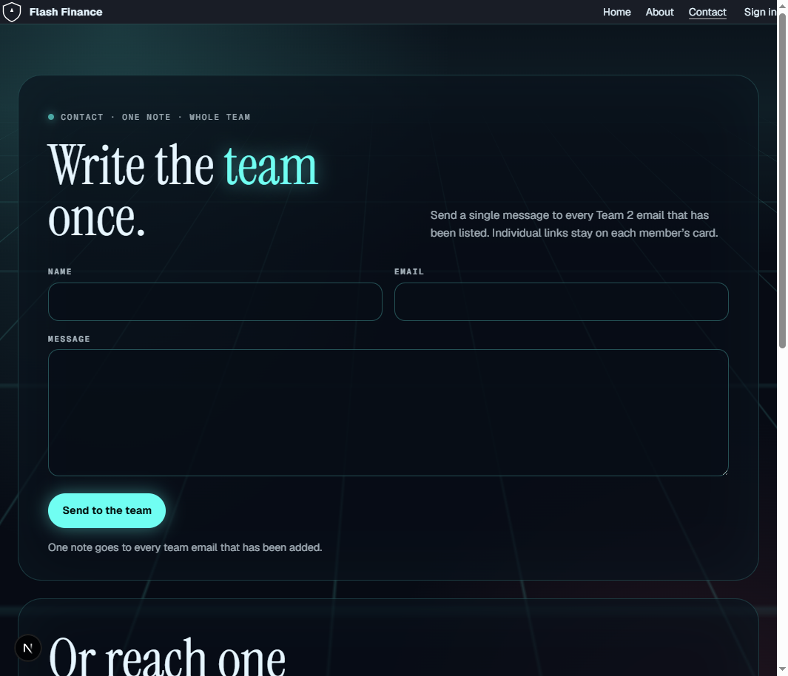
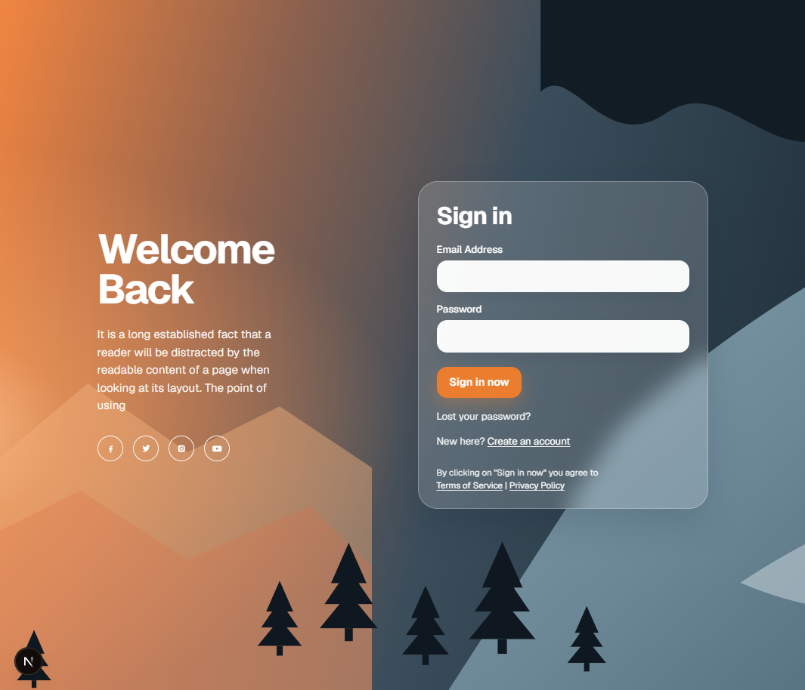
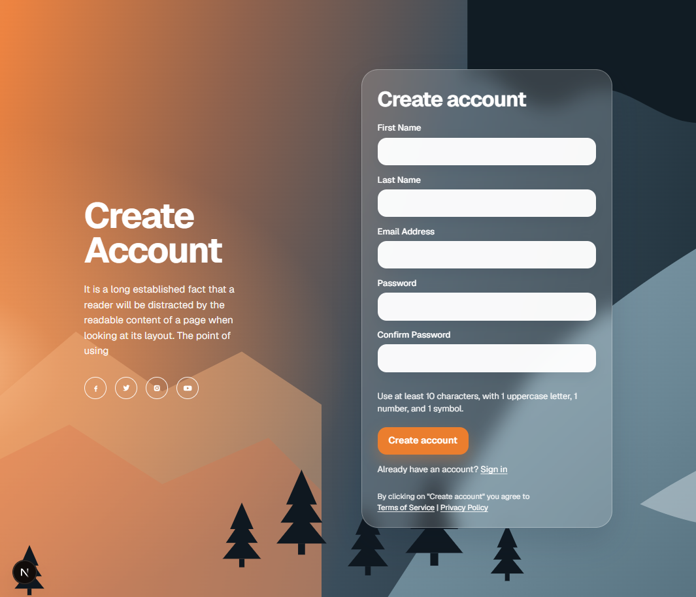

# FlashFinance

**Live Demo:** [FlashFinance](https://flashfinance-phi.vercel.app/)

## Demo Accounts

- **Email:** aldair@example.com
- **Password:** Aldairrutte123#
##
- **Email:** transaction.test@example.com
- **Password:** Wadwadas123##
##
- **Email:** "oluwa01@example.com"
- **Password:** "Oluwaseyi76$$"
##

FlashFinance is a personal finance application for one person and one account. It keeps income and expenses private, organizes them with categories, and shows the balance for the whole account or for a selected month.

Each user registers with an email and password, then works only with their own categories, transactions, and summaries. Another account cannot read or change that data.


## Team Nº 2

| Name | GitHub | Email |
| --- | --- | --- |
| Aldair Rutte Bazán | [DedSec76](https://github.com/DedSec76/wdd430-portfolio) | abazan@byupathway.edu |
| Enoh Uwem Akpan | [enohakpan](https://github.com/enohakpan/wdd430-portfolio) | eakpan11@byupathway.edu |
| Oluwaseyi Elujoba | [oedesign](https://github.com/oedesign/wdd430-portfolio) | oelujoba@byupathway.edu |

## Technologies

- [Next.js](https://nextjs.org/) 16 and React 19 for the interface and route handlers
- TypeScript
- Tailwind CSS 4
- MongoDB with Mongoose
- Zod for request validation
- bcryptjs for password hashing
- pnpm 10

Sign-in is a first-party session. The app stores a hashed session token in MongoDB and sends it in an httpOnly `sessionToken` cookie. It does not use Auth.js or Clerk.

## Architecture

MongoDB is the source of truth. A request passes through one layer at a time:



- **Route handler** (`src/app/api`): reads the HTTP request, the route params, and the signed-in user, then calls a service.
- **Validation** (`src/validations`): checks types, required fields, limits, formats, and enums.
- **Service** (`src/services`): applies business rules, ownership, and whether the operation is allowed.
- **Repository** (`src/repositories`): runs MongoDB queries, inserts, updates, and deletes.
- **Models** (`src/lib/models`): Mongoose schemas for the four collections.

### Data model

- **User** 1:N **Session**, **User** 1:N **Category**, **User** 1:N **Transaction**
- **Transaction** N:1 **Category**, and every transaction belongs to exactly one user
- A category belongs to one user. The app never reads or assigns another user's category.

| Collection | Fields |
| --- | --- |
| User | `_id`, `firstName`, `lastName`, `email`, `passwordHash`, `avatar`, `status`, `failedLoginAttempts`, `lockedUntil`, `createdAt`, `updatedAt` |
| Session | `_id`, `userId`, `deviceId`, `tokenHash`, `expiresAt`, `createdAt`, `lastUsedAt` |
| Category | `_id`, `name`, `normalizedName`, `type`, `userId`, `createdAt`, `updatedAt` |
| Transaction | `_id`, `title`, `amount`, `type`, `categoryId`, `description`, `date`, `userId`, `createdAt`, `updatedAt` |

`type` is `income` or `expense`. A transaction must use a category of the same type. Category names are compared after trimming whitespace and converting to lowercase, so `Food` and ` food ` are the same name for one user.

Amounts are USD, must be greater than 0, and can have at most two decimal places. A transaction date cannot be in the future. A category that already has transactions can be renamed, and it cannot change type or be deleted.

## Installation

Requirements: Node.js 20 or newer, pnpm 10, and a MongoDB database.

```bash
corepack enable
pnpm install
```

Create `.env.local` from the example and set the connection string:

```bash
copy .env.example .env.local
```

On macOS or Linux, use `cp .env.example .env.local`.

Start the app:

```bash
pnpm dev
```

Open [http://localhost:3000](http://localhost:3000).

`pnpm build` then `pnpm start` runs the production server. `pnpm lint` runs ESLint.

There is no shared demo account. Create one from Register. The password must be at least 10 characters and include an uppercase letter, a number, and a symbol. Three failed sign-in attempts lock that account for 10 minutes. Password recovery is not included; the sign-in page points to the team contact page.

## Environment variables

| Name | Required | Purpose |
| --- | --- | --- |
| `MONGODB_URI` | Yes | MongoDB connection string. Local example: `mongodb://127.0.0.1:27017/flashfinance` |

Next.js sets `NODE_ENV`. In production the session cookies are marked `secure`.

Do not commit `.env`, `.env.local`, or a real connection string. `.env.example` only holds a placeholder.

## Main endpoints

Protected endpoints read the `sessionToken` cookie. Without a valid session they respond with `401` and this shape:

```json
{
  "error": {
    "code": "SESSION_INVALID",
    "message": "Authentication required."
  }
}
```

Validation failures use `400` and include `error.fields`. Other failures use `error.code` and `error.message`. The API does not return password hashes or another user's records.

### Auth

| Method | Path | Body | Result |
| --- | --- | --- | --- |
| `POST` | `/api/auth/register` | `firstName`, `lastName`, `email`, `password` | `201` with `id`, `firstName`, `lastName`, `email`, `avatar`, `status` |
| `POST` | `/api/auth/login` | `email`, `password` | `200` and sets httpOnly `sessionToken` and `deviceId` cookies |
| `POST` | `/api/auth/logout` | none | `200` and clears the current session |
| `GET` | `/api/auth/me` | none | `200` with the signed-in user |

Registration does not sign the visitor in by itself. The register page calls login after the account is created.

### Categories

All category routes require a session. Names are trimmed, and duplicates are rejected for that user after lowercase comparison.

| Method | Path | Body | Result |
| --- | --- | --- | --- |
| `GET` | `/api/categories` | none | The signed-in user's categories |
| `POST` | `/api/categories` | `name`, `type` (`income` or `expense`) | `201` with the new category |
| `PATCH` | `/api/categories/:id` | `name`, `type`, or both | The updated category. A category with transactions cannot change type. |
| `DELETE` | `/api/categories/:id` | none | Deletes the category when it has no transactions |

### Transactions

| Method | Path | Body or query | Result |
| --- | --- | --- | --- |
| `GET` | `/api/transactions` | none | The signed-in user's transactions |
| `POST` | `/api/transactions` | `title`, `amount`, `type`, `categoryId`, `description`, `date` | `201` with the new transaction |
| `GET` | `/api/transactions/:id` | none | One transaction owned by the signed-in user |
| `PATCH` | `/api/transactions/:id` | any of the create fields | The updated transaction |
| `DELETE` | `/api/transactions/:id` | none | Deletes that transaction |

`categoryId` is a 24-character hex id. `description` may be `null` and cannot exceed 1,000 characters. `date` is an ISO date string. The category must belong to the same user and have the same `type`.

### Summaries

| Method | Path | Query | Result |
| --- | --- | --- | --- |
| `GET` | `/api/summaries` | none | Overall income, expenses, balance, and totals by category |
| `GET` | `/api/summaries` | `month=YYYY-MM` | The same summary for that calendar month |
| `GET` | `/api/transactions/summary` | `month=YYYY-MM` | `year`, `month`, `income`, `expense`, and `balance` |

Example: `/api/summaries?month=2026-09` and `/api/transactions/summary?month=2026-09`.

### Application pages

| Path | Who can open it |
| --- | --- |
| `/` | Public home page |
| `/about` | Public |
| `/contact` | Public |
| `/login`, `/register` | Public |
| `/dashboard` | Signed-in user |
| `/transactions`, `/transactions/new`, `/transactions/[id]/edit` | Signed-in user |
| `/categories` | Signed-in user |
| `/reports/monthly` | Signed-in user |
| `/profile` | Signed-in user |

## Screenshots

These are the public screens from a local run.

### Home



### About



### Contact



### Sign in



### Register



The dashboard, transaction list, category manager, monthly report, and profile open after sign-in and need a working `MONGODB_URI`.
