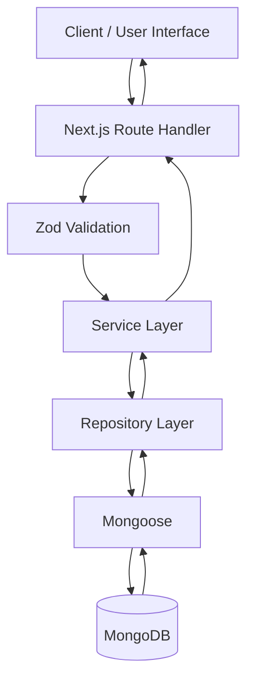

# FlashFinance 💸

**Personal Finance Management Application**

FlashFinance is a personal finance management application that helps users organize their income and expenses, manage transaction categories, monitor their financial balance, and review monthly financial summaries through a centralized interface.

- **Live Demo:** https://flashfinance-phi.vercel.app/
- **GitHub Repository:** https://github.com/DedSec76/flashfinance

## Table of Contents

- [Project Overview](#project-overview)
- [Team Members](#team-members)
- [Technologies](#technologies)
- [Features](#features)
- [Application Architecture](#application-architecture)
- [Data Model](#data-model)
- [Business Rules](#business-rules)
- [Getting Started](#getting-started)
- [Environment Configuration](#environment-configuration)
- [Available Scripts](#available-scripts)
- [Application Pages](#application-pages)
- [API Documentation](#api-documentation)
- [Authentication and Security](#authentication-and-security)
- [Filtering and Pagination](#filtering-and-pagination)
- [Context-Aware Navigation](#context-aware-navigation)
- [Performance and Quality](#performance-and-quality)
- [Screenshots](#screenshots)
- [Known Issues and Opportunities](#known-issues-and-opportunities)

## Project Overview

Managing personal finances can become difficult when income, expenses, and spending categories are recorded in different places. FlashFinance provides a centralized application for recording financial transactions and understanding how money moves over time.

The application is designed for individuals who want to keep track of their finances, organize transactions by category, and review their monthly financial activity.

Its main value is providing a structured way to record income and expenses, calculate financial summaries, and access transaction history through an authenticated interface.

## Team Members

**Team Nº 2**

| Name | Portfolio | Email |
|---|---|---|
| Aldair Rutte Bazán | [GitHub Portfolio](https://github.com/DedSec76/wdd430-portfolio) | abazan@byupathway.edu |
| Enoh Uwem Akpan | [GitHub Portfolio](https://github.com/enohakpan/wdd430-portfolio) | eakpan11@byupathway.edu |
| Oluwaseyi Elujoba | [GitHub Portfolio](https://github.com/oedesign/wdd430-portfolio) | oelujoba@byupathway.edu |

## Technologies

| Technology | Purpose |
|---|---|
| Next.js 16 | Application framework and App Router |
| React 19 | User interface |
| TypeScript | Static typing |
| Tailwind CSS 4 | Styling and responsive layouts |
| MongoDB | Database |
| Mongoose | MongoDB object modeling |
| Zod | Request validation |
| bcryptjs | Password hashing |
| pnpm 10 | Package management |
| Vercel | Production deployment |

## Features

### Authentication and User Accounts

- User registration and login.
- Logout and session management.
- Protected application routes.
- Password hashing.
- Session-based authentication using an HTTP-only cookie.
- Account lockout after three failed sign-in attempts for 10 minutes.

### Transaction Management

- Create, read, update, and delete transactions.
- Classify transactions as income or expenses.
- Associate each transaction with a category of the corresponding type.
- Filter transactions by type, category, month, date range, and amount range.
- Paginate transaction results.
- Validate transaction data before processing requests.

### Category Management

- Create and list transaction categories.
- Rename existing categories.
- Delete categories when business rules permit.
- Separate income categories from expense categories.
- Prevent duplicate category names for the same user, using trimmed, case-insensitive comparison.

### Financial Dashboard and Reports

- View financial information on the dashboard.
- Review transaction history.
- View monthly financial reports and summaries.
- Review account profile information.

## Application Architecture

FlashFinance follows a layered architecture that separates HTTP handling, validation, business logic, database access, and persistence.



### Architectural Responsibilities

- **Route Handlers:** Receive HTTP requests, enforce request-level requirements, and return API responses.
- **Zod:** Validates request data and helps prevent invalid input from reaching business logic.
- **Services:** Apply business rules and coordinate application operations.
- **Repositories:** Encapsulate database queries and persistence operations.
- **Mongoose:** Provides schemas, models, and interaction with MongoDB.
- **MongoDB:** Stores application data, including users, sessions, categories, and transactions.

The application uses Next.js App Router conventions and separates server-side responsibilities from interactive client-side components.

## Data Model

FlashFinance uses MongoDB collections represented by Mongoose models.

### User

Stores account information and authentication-related data.

### Session

Stores session records associated with users. Session tokens are stored as hashes in the database, while the browser receives an HTTP-only session cookie.

### Category

Represents a transaction category owned by a user. Categories distinguish between income and expense transactions.

### Transaction

Stores financial transaction information, including its owner, type, amount, date, description, and associated category.

### Relationships

- A user can have multiple sessions.
- A user can own multiple categories.
- A user can own multiple transactions.
- Each transaction belongs to exactly one user.
- Each transaction references a category belonging to the same user.
- Each transaction must use a category whose type matches the transaction type.

## Business Rules

The application applies the following business rules:

- Transaction types are `income` and `expense`.
- Transaction amounts must be greater than zero.
- Amounts are limited to two decimal places.
- Transaction dates cannot be in the future.
- Transaction amounts are represented in USD.
- A transaction must reference a valid category owned by the same user.
- The transaction type must match the category type.
- Category names are trimmed and compared case-insensitively to prevent duplicates for the same user.
- A category associated with existing transactions can be renamed.
- A category's type cannot be changed when it has associated transactions.
- A category cannot be deleted while it has associated transactions.
- Users must be authenticated to access protected resources.
- Users cannot access or modify another user's records through protected API operations.

## Getting Started

### Prerequisites

Install the following tools before running the application locally:

- Node.js version compatible with the project and Next.js 16.
- pnpm 10.
- A MongoDB instance, either local or hosted on MongoDB Atlas.
- Git.

### 1. Clone the Repository

```bash
git clone https://github.com/DedSec76/flashfinance.git
cd flashfinance
```

### 2. Install Dependencies

```bash
pnpm install
```

### 3. Configure Environment Variables

Create a file named `.env.local` manually in the root directory of the project.

**Do not copy `.env.example`. The repository does not contain that file.**

Add your MongoDB connection string to `.env.local`:

```env
MONGODB_URI=mongodb://127.0.0.1:27017/flashfinance
```

The example above is for a local MongoDB instance. If you use MongoDB Atlas, replace the value with your own connection string.

Keep `.env.local` private. Do not commit database credentials or other secrets to Git.

### 4. Start the Development Server

```bash
pnpm dev
```

Open [http://localhost:3000](http://localhost:3000) in your browser.

### 5. Build for Production

```bash
pnpm build
```

### 6. Run the Production Build Locally

```bash
pnpm start
```

## Environment Configuration

| Variable | Required | Description |
|---|---|---|
| `MONGODB_URI` | Yes | MongoDB connection string used by the application. |

The application requires a valid MongoDB connection to perform database operations.

## Available Scripts

| Command | Description |
|---|---|
| `pnpm dev` | Starts the development server. |
| `pnpm build` | Builds the application for production. |
| `pnpm start` | Starts the production server. |
| `pnpm lint` | Runs the project's linting command. |

## Application Pages

| Route | Access | Description |
|---|---|---|
| `/` | Public | Home page. |
| `/about` | Public | Project information. |
| `/contact` | Public | Contact information. |
| `/login` | Public | Sign-in page. |
| `/register` | Public | Account registration. |
| `/dashboard` | Authenticated | Financial dashboard. |
| `/transactions` | Authenticated | Transaction list and filters. |
| `/transactions/new` | Authenticated | Create a transaction. |
| `/transactions/[id]/edit` | Authenticated | Edit an existing transaction. |
| `/categories` | Authenticated | Manage categories. |
| `/reports/monthly` | Authenticated | Monthly financial reports. |
| `/profile` | Authenticated | User profile. |

## API Documentation

The API is implemented using Next.js Route Handlers. Protected endpoints require a valid session cookie.

### Authentication

| Method | Endpoint | Description |
|---|---|---|
| `POST` | `/api/auth/register` | Registers a new user. |
| `POST` | `/api/auth/login` | Authenticates a user and establishes a session. |
| `POST` | `/api/auth/logout` | Ends the current session. |
| `GET` | `/api/auth/me` | Returns information about the authenticated user. |

Registration creates the account but does not independently establish a signed-in session. The registration page subsequently invokes the login flow.

### Categories

| Method | Endpoint | Description |
|---|---|---|
| `GET` | `/api/categories` | Lists the authenticated user's categories. |
| `POST` | `/api/categories` | Creates a category. |
| `PATCH` | `/api/categories/:id` | Updates an existing category. |
| `DELETE` | `/api/categories/:id` | Deletes a category when permitted by business rules. |

Category operations are restricted to the authenticated user's records.

### Transactions

| Method | Endpoint | Description |
|---|---|---|
| `GET` | `/api/transactions` | Lists transactions and supports filtering and pagination. |
| `POST` | `/api/transactions` | Creates a transaction. |
| `GET` | `/api/transactions/:id` | Retrieves a transaction by ID. |
| `PATCH` | `/api/transactions/:id` | Updates a transaction. |
| `DELETE` | `/api/transactions/:id` | Deletes a transaction. |

The transaction endpoints validate request data and enforce ownership and category rules.

### Financial Summaries

| Method | Endpoint | Description |
|---|---|---|
| `GET` | `/api/summaries` | Retrieves financial summary information. |
| `GET` | `/api/transactions/summary?month=YYYY-MM` | Retrieves a transaction summary for a specified month. |

The `/api/summaries` endpoint optionally accepts the `month=YYYY-MM` query parameter.

### Transaction Query Parameters

The transaction list endpoint supports the following query parameters:

| Parameter | Description |
|---|---|
| `type` | Filters by transaction type: `income` or `expense`. |
| `categoryId` | Filters by category ID. The ID must be a 24-character hexadecimal MongoDB ObjectId. |
| `month` | Filters by month using the `YYYY-MM` format. |
| `startDate` | Specifies the lower date boundary for the transaction filter. |
| `endDate` | Specifies the upper date boundary for the transaction filter. The current implementation uses an exclusive upper boundary; do not assume that the entire calendar day is included without verifying the date construction and query logic. |
| `minAmount` | Filters by minimum amount. |
| `maxAmount` | Filters by maximum amount. |
| `page` | Specifies the result page. |
| `limit` | Specifies the maximum number of results per page. |

Filters can be combined where supported by the endpoint.

### Validation and Error Responses

- Protected endpoints require a valid session.
- An invalid or missing session returns HTTP `401` with the `SESSION_INVALID` error code.
- Invalid request data returns HTTP `400`; validation responses can include field-level details under `error.fields`.
- The API does not expose password hashes.
- Database operations must enforce user ownership and applicable business rules.

For exact request bodies and response schemas, refer to the corresponding Route Handler, Zod schema, and service implementation in the repository.

## Authentication and Security

FlashFinance implements custom session-based authentication rather than relying on Auth.js or Clerk.

The authentication flow includes:

1. Password hashing with `bcryptjs`.
2. Session creation following successful authentication.
3. Storage of a hashed session token in MongoDB.
4. An HTTP-only `sessionToken` cookie in the browser.
5. Session validation for protected application routes and API operations.
6. Session termination through the logout endpoint.
7. Account lockout for 10 minutes after three failed sign-in attempts.

### Security Considerations

- Do not commit `.env.local` or real database credentials.
- Do not use publicly shared demo accounts for personal financial information.
- Production database access should follow the principle of least privilege.
- Review MongoDB Atlas network access settings and use restricted access or an appropriate private connectivity solution where available.

## Filtering and Pagination

The transactions interface supports filtering by:

- Transaction type.
- Category.
- Month.
- Start date (`startDate`).
- End date (`endDate`).
- Minimum amount (`minAmount`).
- Maximum amount (`maxAmount`).

Pagination is available through the `page` and `limit` query parameters.

**Date-boundary note:** The current implementation uses an exclusive upper boundary for `endDate`. Its exact calendar-day behavior depends on how the date value is constructed and passed to the database query. The application documentation therefore does not promise full-day inclusion without further verification.

## Context-Aware Navigation

Selected transaction creation and editing flows support contextual navigation through a `returnTo` parameter.

This allows supported flows to return users to the relevant application section after an operation. However, preservation of the exact originating transaction filters and pagination state should not be assumed for every navigation path.

## Performance and Quality

FlashFinance was evaluated using Google Lighthouse in desktop and mobile environments.

The reported scores were **above 94 in every Lighthouse category across all evaluated pages**, according to the project's completed evaluation.

| Lighthouse Category | Reported Result |
|---|---|
| Performance | Above 94 |
| Accessibility | Above 94 |
| Best Practices | Above 94 |
| SEO | Above 94 |

These results reflect the Lighthouse evaluations performed on the application. Keep the corresponding reports or screenshots as supporting evidence.

The application also uses TypeScript, reusable UI components, request validation, protected routes, and a layered database architecture.

## Screenshots

The repository documentation references the following screenshots:

- `docs/screenshots/home.png`
- `docs/screenshots/about.png`
- `docs/screenshots/contact.png`
- `docs/screenshots/login.png`
- `docs/screenshots/register.png`

Ensure these files exist in the repository and that their paths and filenames match the references before relying on them in the rendered README.

## Known Issues and Opportunities

The following items are documented as limitations or areas for further verification and improvement:

1. **Password recovery:** A password recovery flow is not currently implemented. The sign-in page directs users to the team's contact page.
2. **End-date filter verification:** Confirm the exact date construction and exclusive upper-bound behavior of `endDate` before claiming that the filter includes the entire selected day.
3. **Context-aware navigation:** Verify whether every relevant creation and editing flow preserves the exact originating filters and pagination state.
4. **Automated testing:** Expand automated test coverage for authentication, authorization, validation, transaction CRUD, category rules, and date filtering.
5. **Reporting enhancements:** Additional financial reports and analytical capabilities may be considered as future improvements.

## Demo Accounts

The following shared accounts are available for trying the deployed application. Their credentials are published for demonstration purposes and should not be considered private.

| Email | Password |
|---|---|
| `aldair@example.com` | `Aldairrutte123#` |
| `transaction.test@example.com` | `Wadwadas123##` |
| `oluwa01@example.com` | `Oluwaseyi76$$` |

**Important:** These are shared demonstration accounts. Other visitors may use the same accounts and modify their data. Do not store personal, sensitive, or real financial information in them. Do not reuse these passwords for personal accounts.

## Deployment

FlashFinance is deployed on Vercel:

https://flashfinance-phi.vercel.app/

The production deployment requires the appropriate MongoDB connection string to be configured in the deployment environment.

For local development, configure `MONGODB_URI` in the manually created `.env.local` file. For production, configure the equivalent environment variable in the hosting provider's environment settings. Never expose the production connection string in the repository or README.

---

**FlashFinance — A centralized way to track income, expenses, categories, and monthly financial activity.**
